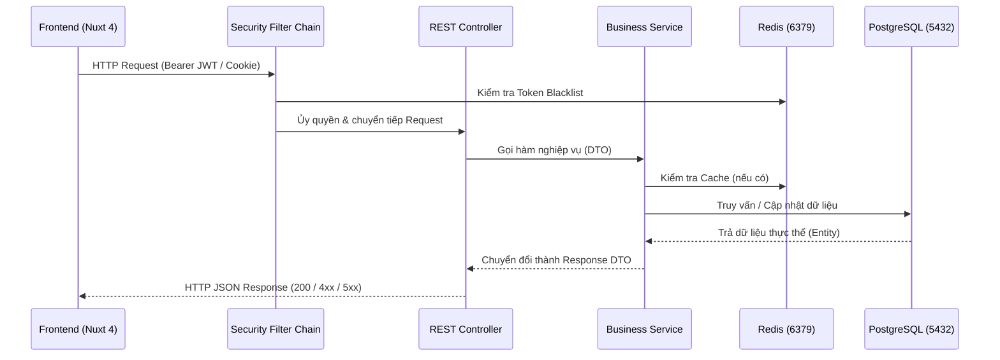

# KIẾN TRÚC & LUỒNG DỮ LIỆU (ARCHITECTURE & FLOWS)

## 1. Luồng Giao Tiếp BE <-> FE
- Giao tiếp qua HTTP RESTful API với định dạng trao đổi dữ liệu `application/json`.
- **CORS Policy:** Được cấu hình tại `CorsConfig.java` cho phép các origin client (`http://localhost:3000`, `http://localhost:3001`), hỗ trợ `AllowCredentials = true`.
- **Tải tệp & Media:** File upload tĩnh được phục vụ tại `/uploads/**` và mapping URL lưu trong DB.

## 2. Xác Thực & Phân Quyền (Authentication & Authorization)
- **Cơ chế:** Sử dụng Access Token (JWT) và Refresh Token kết hợp Spring Security OAuth2 Resource Server.
- **Access Token:**
  - Định dạng: JWT (chứa `sub`, `roles`, `iat`, `exp`).
  - Truyền tải: Gửi kèm header `Authorization: Bearer <access_token>` trong mỗi request yêu cầu xác thực.
- **Refresh Token:**
  - Lưu tại cookie `refresh_token` với cờ `HttpOnly = true`, `SameSite = Strict`, thời hạn 14 ngày.
  - Hỗ trợ endpoint `/auth/refresh` cấp mới access token khi hết hạn mà người dùng không cần đăng nhập lại.
- **Đăng xuất & Thu hồi Token:**
  - Token bị thu hồi sẽ được đưa vào danh sách đen (`BlacklistedToken` lưu tại DB/Redis) để ngăn chặn tái sử dụng.
- **Phân Quyền Vai Trò (Roles):**
  - `ROLE_USER`: Khách hàng xem/sửa thông tin cá nhân, quản lý giỏ hàng, đặt hàng, xem lịch sử đơn hàng.
  - `ROLE_ADMIN`: Toàn quyền quản trị danh mục, sản phẩm, kho hàng, người dùng và xem báo cáo.
  - **Phân tầng bảo mật:**
    - URL matcher: `/api/admin/**` -> `hasRole('ADMIN')`, `/api/user/**` -> `hasAnyRole('USER', 'ADMIN')`.
    - Method-level security: Kích hoạt `@EnableMethodSecurity` sử dụng `@PreAuthorize("hasRole('ADMIN')")` trực tiếp trên các hàm Controller.

## 3. Quy Ước Thiết Kế (Design Conventions)
1. **DTO Pattern:**
   - Tuyệt đối không để Entity Hibernate rò rỉ trực tiếp ra ngoài REST Controller.
   - Luôn sử dụng Request DTO cho payload đầu vào và Response DTO cho dữ liệu đầu ra.
2. **Xử Lý Lỗi Tập Trung:**
   - Toàn bộ exception được gom về `GlobalExceptionHandler` (`@RestControllerAdvice`).
   - Chuẩn hóa payload trả về khi có lỗi: `{ "error": "Chi tiết lỗi", "message": "Thông điệp người dùng" }`.
3. **Quản Lý Trạng Thái Frontend:**
   - Trạng thái đăng nhập và giỏ hàng được quản lý qua Composables (`useAuth`, `useCart`) với Cookie/Local state đồng bộ.
   - Sử dụng Nuxt Route Middleware (`auth.ts`, `admin.ts`, `guest.ts`) để bảo vệ các trang điều hướng phía client.
